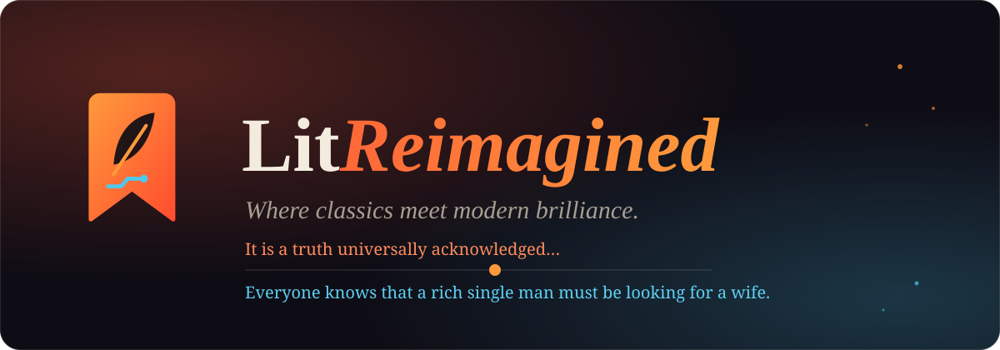

<div align="center">



<br />

*A reading room for the great old books, with the lamp turned up.*

<br />

**Next.js 16** · **TypeScript** · **Tailwind CSS 4** · **Supabase** · **Gemini** · *runs with zero keys*

</div>

---

## ✦ The idea

Classics are wonderful and, sometimes, a wall. **LitReimagined** keeps the author's own words on one side and a fresh retelling on the other, then lets you **slide between them**.

> *It is a truth universally acknowledged…*
> &nbsp;&nbsp;&nbsp;&nbsp;↕ slide ↕
> *Everyone knows that a rich single man must be looking for a wife.*

Read the original when you feel brave. Slide toward modern when the sentence runs away from you. Nothing is lost; the book is still the book.

## ✦ What you can do

| | |
|---|---|
| 🪶 **Slide the voice** | Move from the original to a *Light*, *Modern* or *Contemporary* retelling, side by side with the source text. |
| 🔍 **Tap an old word** | Archaic words open a small, per-book glossary. No tab-switching, no dictionary rabbit holes. |
| 🖍 **Highlight & annotate** | Mark passages, keep notes, turn a favourite line into a quote card. |
| ✒️ **Ask the quill** | An AI companion that rewrites or explains a passage. Its output is always labelled as AI. |
| 🧭 **Find your next book** | Describe a mood; semantic search (pgvector) points you to a shelf. |
| 🔥 **Keep a reading rhythm** | Streaks, a personal library and read-aloud, for the long evenings. |
| 🌗 **Night & parchment** | Ink `#0E0C14` after dark, Paper `#F4ECDD` by day. |

## ✦ Step inside

```bash
npm install
npm run dev        # → http://localhost:3000
```

**No keys needed.** Without Supabase and Gemini credentials the app opens in **demo mode**: twelve classics with sample chapters, a mock quill, and your reading data kept in the browser. Add real keys later and it switches over with no code changes. See [docs/going-live.md](docs/going-live.md).

Copy `.env.example` to `.env.local` when you're ready. Empty or placeholder values simply mean "not configured".

## ✦ The shelf (demo library)

*Pride and Prejudice* · *Frankenstein* · *Dracula* · *Jane Eyre* · *Wuthering Heights* · *Great Expectations* · *The Picture of Dorian Gray* · *Crime and Punishment* · *Moby-Dick* · *Alice's Adventures in Wonderland* · *Romeo and Juliet* · *The Odyssey*

## ✦ Behind the curtain

```
app/            routes: (site) pages · (auth) sign-in · read/ the immersive reader · api/ai/* live AI
components/     reader, book, brand doodles, motion, layout
lib/data/       the repository layer: Supabase when configured, bundled demo data otherwise
lib/ai/         the AI gateway: validation, shared cache, daily allowances, circuit breaker, Gemini or demo
lib/client/     browser stores for guest data and account sync
scripts/        the content pipeline
supabase/       database migrations
config/         site and AI settings (models and limits are env-tunable)
```

Pages read through a single interface, so the app quietly falls back to demo data if the database is empty or unreachable. The AI gateway guards the quill with per-visitor and per-network allowances and a site-wide circuit breaker.

## ✦ Scripts

| Command | What it does |
|---|---|
| `npm run dev` · `build` · `start` | Run, build and serve |
| `npm run typecheck` · `lint` · `test` | Types, lint, unit tests |
| `npm run test:e2e` | Playwright end-to-end and accessibility checks |
| `npm run content:seed` | Load authors, books and collections into Supabase |
| `npm run content:ingest` | Fetch and split books from Project Gutenberg (`-- --dry-run` previews offline) |
| `npm run content:translate` | Generate Light / Modern / Contemporary versions (`-- --mock`, `--levels 2`, `--book <slug>`) |
| `npm run content:glossary` | Build per-book glossaries |
| `npm run content:embed` | Create search embeddings for "find my next book" |
| `npm run content:status` | Show pipeline progress |
| `npm run content:revalidate` | Refresh the live site's cached catalogue |

## ✦ Look & feel

<table>
<tr>
<td width="50%" valign="top">

**Palette**

| | |
|---|---|
| Ember | `#FF5A36` → `#FF9A3C` |
| Circuit *(AI, live)* | `#4CC9F0` |
| Blush | `#E9B8A6` |
| Dusty | `#8FA9C4` |
| Sage | `#9DB39A` |
| Ink · Paper | `#0E0C14` · `#F4ECDD` |

</td>
<td width="50%" valign="top">

**Type & voice**

- **Fraunces** for display
- **Inter** for the interface
- **Newsreader** for reading

Warm, literate, a little playful, never gimmicky. More in [docs/brand.md](docs/brand.md).

</td>
</tr>
</table>

The mark is an ember bookmark holding a quill whose tip sparks a small circuit line: classic craft, modern intelligence.

## ✦ Texts & honesty

The original texts are public domain, courtesy of [Project Gutenberg](https://www.gutenberg.org). The modern versions are **AI-assisted adaptations** and are labelled as such everywhere in the app.

<div align="center">

<br />

*Turn the page. The old books are waiting, and they've been practising their small talk.*

</div>
